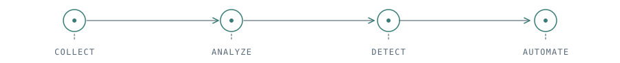

  
01 / PROFILE

  <h1>Security Operations &amp; Network Security</h1>
  
<strong>Entry-level · SOC / SIEM · Detection Engineering · Automation</strong>

  
  
보안 운영과 네트워크 보안을 중심으로 로그와 트래픽을 분석하고, 탐지·알림 흐름을 프로젝트로 구현해 왔습니다. 프로젝트에서는 맡은 역할과 검증 범위를 구분해 기록합니다.

  

    
    
    
  

---

02 / SELECTED WORK

## Featured Projects

<table width="100%">
  <tbody>
    <tr>
      <td colspan="2" valign="top">
        
<strong>01 / FLAGSHIP · TEAM PROJECT</strong>

        <h2>NEXUS WORK</h2>
        
<strong>Security Monitoring &amp; AI-XDR Integration</strong>

        
4인 팀 프로젝트에서 Wazuh 호스트 로그 연동, Graylog R1–R12 탐지 규칙 설정·검증, Published n8n workflow의 Ticket 처리와 AI-XDR 연결을 담당했습니다.

        
AI-XDR 결과는 관리자 검토·승인 흐름으로 전달됩니다.

        
<code>Wazuh</code> &nbsp;→&nbsp; <code>Graylog</code> &nbsp;→&nbsp; <code>n8n</code> &nbsp;→&nbsp; <code>AI-XDR</code> &nbsp;→&nbsp; <code>Admin Review</code>

        

        
<a href="https://github.com/Gilin03/nexus_work">Repository</a> &nbsp;·&nbsp; <a href="https://app.notion.com/p/413d401b317c81cb980ed80b4fad7736">Case Study</a> &nbsp;·&nbsp; <a href="https://nexus-work-portfolio-site.vercel.app/">Demo</a>

      </td>
    </tr>
    <tr>
      <td width="50%" valign="top">
        
<strong>02 / PERSONAL PROJECT · CASEBOOK</strong>

        <h3>SOC Threat Hunting</h3>
        
<strong>PCAP Analysis · SSH Honeypot Investigation</strong>

        
CIC-IDS2017 PCAP에서 포트 스캔 흐름을 분석하고, SSH Honeypot의 145,425개 이벤트에서 반복 인증 시도와 동일 Session의 로그인 후 명령을 추적했습니다. 관찰 근거와 판단을 분리해 탐지 아이디어를 정리했습니다.

        
<code>Wireshark</code> · <code>PCAP</code> · <code>SSH</code> · <code>Python</code>

        
<a href="https://github.com/Gilin03/SOC-Threat-Hunting-Detection-Engineering">Repository</a> &nbsp;·&nbsp; <a href="https://github.com/Gilin03/SOC-Threat-Hunting-Detection-Engineering/tree/main/cases/case01-portscan">CASE-01 · PCAP</a> &nbsp;·&nbsp; <a href="https://github.com/Gilin03/SOC-Threat-Hunting-Detection-Engineering/blob/main/cases/case02-ssh-bruteforce/README.md">CASE-02 · SSH</a> &nbsp;·&nbsp; <a href="https://app.notion.com/p/413d401b317c816ba396f7b96ab44b73">Case Study</a>

      </td>
      <td width="50%" valign="top">
        
<strong>03 / PERSONAL PROJECT · SIMULATION</strong>

        <h3>Login Defense Lab</h3>
        
<strong>Detection Policy Evaluation</strong>

        
5개 시나리오를 10회씩 실행하고 IP 단일·계정 단일·다중 신호 정책을 150회 평가했습니다. 공격 탐지와 정상 사용자 강제 차단을 별도 지표로 비교했습니다.

        
<code>Python</code> · <code>React</code> · <code>Detection Policy</code>

        
<a href="https://github.com/Gilin03/login-defense-lab">Repository</a> &nbsp;·&nbsp; <a href="https://app.notion.com/p/413d401b317c810eb7ddd51cca0a91bf">Case Study</a> &nbsp;·&nbsp; <a href="https://login-defense-lab-psi.vercel.app/">Demo</a>

      </td>
    </tr>
  </tbody>
</table>

---

## 03 / Tech Stack

<small>기술은 팀 프로젝트와 개인 프로젝트에서 사용한 역할에 따라 정리했습니다.</small>

<table width="100%">
  <tbody>
    <tr>
      <td width="50%" valign="top">
        
<strong>SECURITY MONITORING / ANALYSIS</strong>

         
        
      </td>
      <td width="50%" valign="top">
        
<strong>NETWORK / TEAM ENVIRONMENT</strong>

         
         
      </td>
    </tr>
    <tr>
      <td width="50%" valign="top">
        
<strong>AUTOMATION / BACKEND</strong>

         
         
         
      </td>
      <td width="50%" valign="top">
        
<strong>APPLICATION / DATA / IDENTITY</strong>

         
         
         
        
         
      </td>
    </tr>
  </tbody>
</table>

---

## 04 / Additional Projects

- [Login Alert Automation](https://github.com/Gilin03/n8n-security-alert-bot) · [loginbot](https://github.com/Gilin03/loginbot) — n8n 로그인 경보 흐름과 Flask/MySQL 이벤트 대시보드.
- [WebAuthn Passkey](https://github.com/Gilin03/webauthn-passkey-auth) — Supabase Edge Function에서 challenge와 signature를 검증하는 패스키 인증.
- [BYTE BACK](https://github.com/Gilin03/choi-bujang-secret-vault) — Vercel Functions의 JWT 검증과 사용자별 데이터 접근 제어.
- [Visit Jeju Backend](https://github.com/Gilin03/Visit_Jeju_Backend) — Java·Spring Boot 기반 백엔드 프로젝트.
