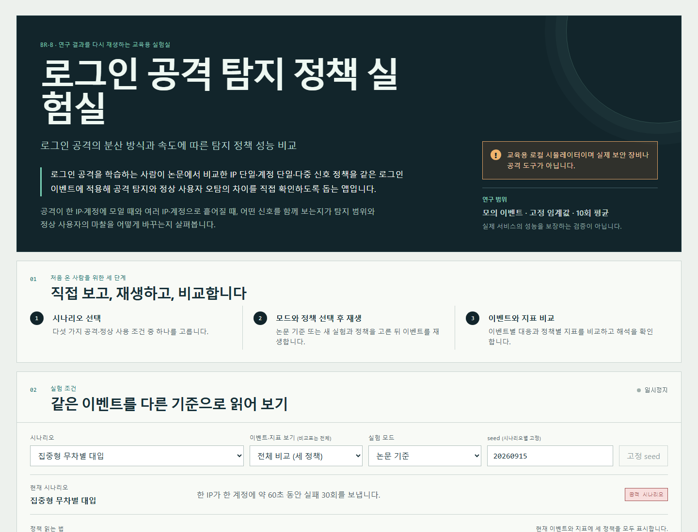

# Security Monitoring & Detection Engineering

**Entry-level SOC Analyst · 신입 SOC / 보안관제 지원**

보안 이벤트 수집과 로그 분석, Graylog 탐지 규칙, n8n 자동화 연동을 프로젝트 환경에서 구현하고 검증했습니다.

[Notion Portfolio](https://app.notion.com/p/413d401b317c813b90ded756a4458810) · [NEXUS WORK Web Portfolio](https://nexus-work-portfolio-site.vercel.app/) · [Featured Projects ↓](#featured-projects)

---

## Featured Projects

### NEXUS WORK

**4인 팀 통합 보안관제 · 로그 연동, 탐지 규칙, 자동화의 개인 담당**

- **담당:** Wazuh 호스트 로그 연동, Graylog R1–R12 탐지 규칙, n8n Ticket 처리와 AI-XDR 연결·흐름 검증
- **흐름:** Wazuh / 보안 이벤트 → Graylog → n8n → AI-XDR 평가 → 관리자 검토
- Suricata·pfSense·Flask·MySQL는 팀 전체 시스템 구성입니다. AI-XDR 평가 결과는 관리자 검토에 연결했으며, 권고 자체가 네트워크 차단 실행을 뜻하지 않습니다.

[Repository](https://github.com/Gilin03/nexus_work) · [Details](https://app.notion.com/p/413d401b317c81cb980ed80b4fad7736) · [Demo](https://nexus-work-portfolio-site.vercel.app/)

### SOC Threat Hunting & Detection Engineering

**PCAP 및 SSH Honeypot 이벤트 분석 기반 Casebook**

- CIC-IDS2017 PCAP에서 SYN → SYN/ACK → RST와 약 999개의 고유 목적지 TCP 포트를 관찰했습니다.
- 별도 SSH Honeypot 145,425개 이벤트에서 반복 자격 증명 입력과 로그인 이후 명령 이벤트를 구분했습니다.
- 초기 탐지 기준은 같은 Source–Destination의 60초 내 포트 100개 이상입니다. 전체 관찰값 999개와 다른 측정 범위의 설계 초안입니다.

[Repository](https://github.com/Gilin03/SOC-Threat-Hunting-Detection-Engineering) · [Details](https://app.notion.com/p/413d401b317c816ba396f7b96ab44b73)

### Login Defense Lab

**같은 모의 로그인 이벤트로 세 가지 탐지 정책을 비교한 개인 시뮬레이터**

- IP 단일·계정 단일·다중 신호 정책을 같은 모의 이벤트에 각각 적용했습니다.
- 정의된 4개 공격 시나리오에서 각 10회 실행 중 한 번 이상 대응한 실행 비율 평균은 **100%**였습니다. 전체 공격 이벤트 차단률이나 실제 서비스 성능은 아닙니다.
- 공유망 정상 시나리오의 정상 이벤트 중 **강제 차단률은 다중 신호 0%, IP 단일 64.6%**였습니다. 공격 실행 탐지율과는 별도 지표입니다.

[Repository](https://github.com/Gilin03/login-defense-lab) · [Details](https://app.notion.com/p/413d401b317c810eb7ddd51cca0a91bf) · [Demo](https://login-defense-lab-psi.vercel.app/)

---

## Technical Experience

### Monitoring / SIEM
**Wazuh · Graylog** — NEXUS WORK에서 호스트 로그 전달 경로와 Graylog R1–R12 탐지 규칙을 연결했습니다.

### Detection / Investigation
**PCAP · Wireshark** — SOC Casebook에서 포트 탐색 패킷과 SSH Honeypot 이벤트를 분석했습니다. **Python** — Login Defense Lab에서 모의 이벤트 생성과 정책 비교에 사용했습니다. **Suricata**는 NEXUS WORK 팀 인프라에 포함된 구성 요소입니다.

### Security Automation
**n8n · Webhook · REST API** — 경보 정규화, Ticket 생성·병합, AI-XDR API 요청과 결과 후속 흐름을 연결했습니다.

### Application Security
**JavaScript · Node.js · Supabase Auth · JWT** — BYTE BACK에서 검증된 로그인 주체와 사용자별 메모 API 권한 검사를 연결했습니다.

---

## Additional Projects

- **[BYTE BACK](https://github.com/Gilin03/choi-bujang-secret-vault)** — Vercel Functions의 Supabase Auth 세션·JWT 검증과 사용자별 메모 소유권 확인을 구현했습니다. [Notion 상세](https://app.notion.com/p/413d401b317c8123a66ae3f95e99e74c)
- **[WebAuthn Passkey](https://github.com/Gilin03/webauthn-passkey-auth)** — Supabase Edge Function에서 WebAuthn challenge와 서명을 검증하고 세션을 처리합니다.
- **[PlanDoSee Auth](https://github.com/Gilin03/PlanDoSee-Auth)** — Supabase Auth 기반 계획·실행·회고 앱입니다. DB 마이그레이션과 RLS 정책 파일은 저장소에 없으며 배포 환경에서 별도 구성이 필요합니다.

---

## Portfolio / Links

[Notion Portfolio](https://app.notion.com/p/413d401b317c813b90ded756a4458810) · [NEXUS WORK Repository](https://github.com/Gilin03/nexus_work) · [SOC Casebook](https://github.com/Gilin03/SOC-Threat-Hunting-Detection-Engineering) · [Login Defense Lab](https://github.com/Gilin03/login-defense-lab)

[NEXUS WORK Demo](https://nexus-work-portfolio-site.vercel.app/) · [Login Defense Lab Demo](https://login-defense-lab-psi.vercel.app/)
